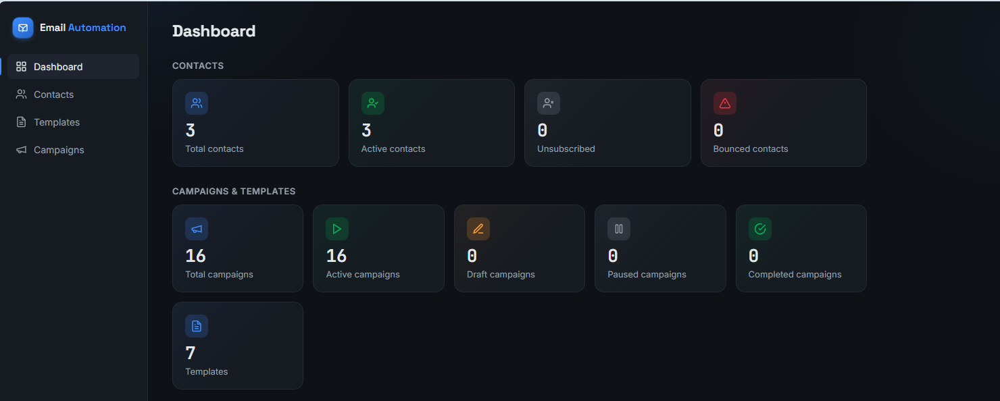
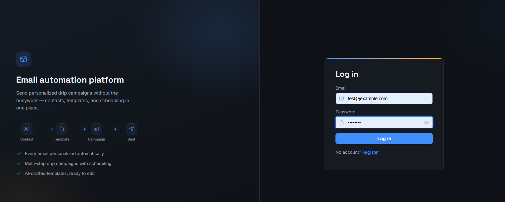
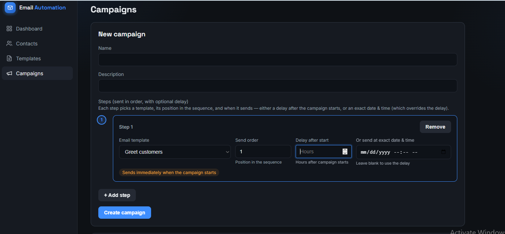
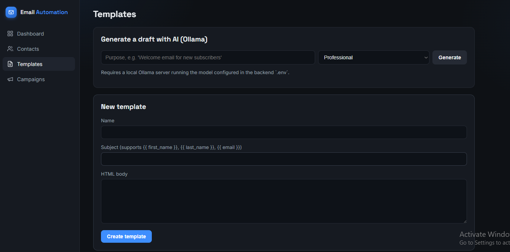
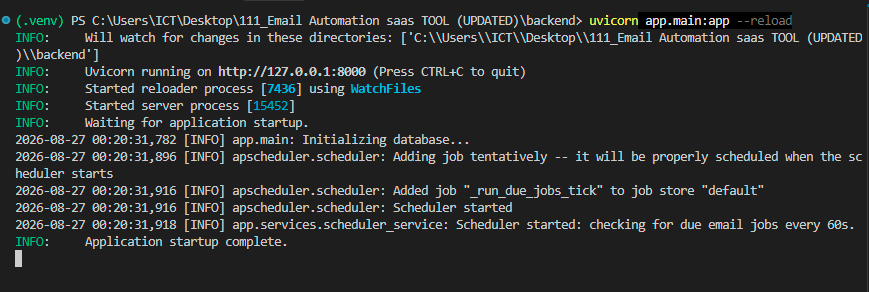
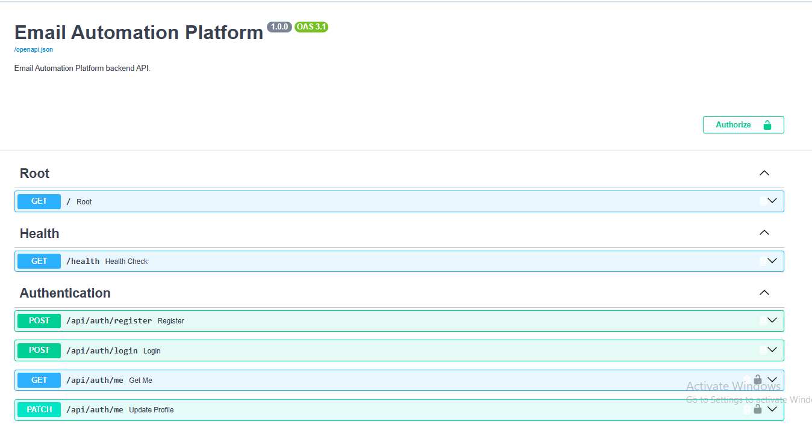

<div align="center">

# 📧 Email Automation Platform

### A full-stack email automation platform with AI-assisted drafting, multi-step drip campaigns, contact management, and analytics.


</div>

---

## 📚 Table of Contents

- [Features](#-features)
- [Screenshots](#️-screenshots)
- [Tech Stack](#️-tech-stack)
- [Project Structure](#-project-structure)
- [Quick Start](#-quick-start)
- [License](#-license)

---

## ✨ Features

- 🔐 **JWT Authentication** — secure, per-user data isolation
- 👥 **Contacts** — full CRUD, CSV import with validation/deduplication, and multi-select bulk delete
- 📝 **Templates** — reusable email templates with dynamic variables (`{{ first_name }}`, `{{ last_name }}`, `{{ email }}`, `{{ full_name }}`) and AI-assisted drafting
- 📬 **Campaigns** — multi-step drip sequences with a visual step timeline and configurable per-step delay or exact scheduled time
- 🤖 **AI Drafting** — subject + body generation, subject-only mode, and content personalization via a local Ollama model
- ⏱️ **Automated Delivery** — in-process background scheduler polls for due steps and sends via [Brevo](https://www.brevo.com/)
- 📊 **Analytics** — campaign performance summary and dashboard view
- 🗄️ **Schema Migrations** — managed with Alembic, applied automatically on startup

---

## 🖼️ Screenshots

<div align="center">

**Dashboard**


**Login**


**Campaigns — Drip Sequence Builder**


**Templates**


**Backend Console**


**Swagger API Docs**


</div>

---

## 🛠️ Tech Stack

<div align="center">


</div>

| Layer | Technology |
|---|---|
| **Backend** | FastAPI, SQLAlchemy 2.0, Alembic, MySQL |
| **Auth** | JWT (python-jose), bcrypt password hashing |
| **Frontend** | React 18, Vite, React Router |
| **AI** | Ollama (local LLM) |
| **Email Delivery** | Brevo API |
| **Scheduling** | APScheduler |
| **Testing** | Pytest |

---

## 📁 Project Structure

```
Email-Automation-Tool/
│
├── Images/                        # Screenshots used in this README
│   ├── Dashboard.png
│   ├── Login_Page.png
│   ├── Campaigns.png
│   ├── Templates.png
│   ├── Console_preview.png
│   └── Swagger_ui.png
│
├── backend/
│   ├── app/
│   │   ├── api/
│   │   │   ├── router.py          # Aggregates all route modules
│   │   │   └── routes/
│   │   │       ├── auth.py
│   │   │       ├── contacts.py
│   │   │       ├── templates.py
│   │   │       ├── campaigns.py
│   │   │       ├── ai.py
│   │   │       └── analytics.py
│   │   ├── core/
│   │   │   ├── config.py          # Settings (env-based)
│   │   │   ├── security.py        # JWT + password hashing
│   │   │   └── exceptions.py
│   │   ├── database/
│   │   │   ├── base.py
│   │   │   ├── connection.py
│   │   │   └── migrations.py
│   │   ├── dependencies/
│   │   │   └── auth.py            # Current-user dependency
│   │   ├── models/                # SQLAlchemy ORM models
│   │   │   ├── user.py
│   │   │   ├── contact.py
│   │   │   ├── template.py
│   │   │   ├── campaign.py
│   │   │   └── email_job.py
│   │   ├── schemas/                # Pydantic request/response schemas
│   │   ├── services/                # Business logic layer
│   │   │   ├── campaign_service.py
│   │   │   ├── contact_service.py
│   │   │   ├── email_service.py
│   │   │   ├── ollama_service.py
│   │   │   ├── scheduler_service.py
│   │   │   ├── template_engine.py
│   │   │   └── template_service.py
│   │   └── main.py                # FastAPI app entrypoint
│   ├── alembic/                    # Database migration scripts
│   ├── tests/                      # Pytest test suite
│   ├── requirements.txt
│   └── .env.example
│
├── frontend/
│   ├── src/
│   │   ├── components/
│   │   │   ├── AuthBrandPanel.jsx
│   │   │   ├── Layout.jsx
│   │   │   └── icons.jsx
│   │   ├── context/
│   │   │   ├── AuthContext.jsx
│   │   │   └── ConfirmContext.jsx
│   │   ├── pages/
│   │   │   ├── Login.jsx
│   │   │   ├── Register.jsx
│   │   │   ├── Dashboard.jsx
│   │   │   ├── Contacts.jsx
│   │   │   ├── Templates.jsx
│   │   │   ├── Campaigns.jsx
│   │   │   └── CampaignDetail.jsx
│   │   ├── api.js                  # Centralized API client
│   │   ├── index.css
│   │   ├── App.jsx
│   │   └── main.jsx
│   ├── package.json
│   └── .env.example
│
├── .gitignore
├── LICENSE
└── README.md
```

---

## 🚀 Quick Start

### Prerequisites
- Python 3.13+
- Node.js 18+
- MySQL running locally
- [Ollama](https://ollama.com/) (optional, for AI drafting features)
- A [Brevo](https://www.brevo.com/) account + API key (for sending emails)

### Backend

```bash
cd backend
python -m venv venv
source venv/bin/activate      # Windows: venv\Scripts\activate
pip install -r requirements.txt
cp .env.example .env          # fill in DB credentials, Brevo API key, and a strong SECRET_KEY
uvicorn app.main:app --reload
```

### Frontend

```bash
cd frontend
npm install
cp .env.example .env
npm run dev
```

Open **http://localhost:5173**, register an account, and work through **Contacts → Templates → Campaigns**.

Interactive API docs (Swagger UI) are available at **http://localhost:8000/docs** once the backend is running.

---

## 📄 License

This project is licensed under the **MIT License** — you're free to use, copy, modify, merge, publish, and distribute it, provided the original copyright notice is included.

```
MIT License

Copyright (c) 2026 Abdullah Amin

Permission is hereby granted, free of charge, to any person obtaining a copy
of this software and associated documentation files (the "Software"), to deal
in the Software without restriction, including without limitation the rights
to use, copy, modify, merge, publish, distribute, sublicense, and/or sell
copies of the Software, and to permit persons to whom the Software is
furnished to do so, subject to the following conditions:

The above copyright notice and this permission notice shall be included in all
copies or substantial portions of the Software.

THE SOFTWARE IS PROVIDED "AS IS", WITHOUT WARRANTY OF ANY KIND, EXPRESS OR
IMPLIED, INCLUDING BUT NOT LIMITED TO THE WARRANTIES OF MERCHANTABILITY,
FITNESS FOR A PARTICULAR PURPOSE AND NONINFRINGEMENT. IN NO EVENT SHALL THE
AUTHORS OR COPYRIGHT HOLDERS BE LIABLE FOR ANY CLAIM, DAMAGES OR OTHER
LIABILITY, WHETHER IN AN ACTION OF CONTRACT, TORT OR OTHERWISE, ARISING FROM,
OUT OF OR IN CONNECTION WITH THE SOFTWARE OR THE USE OR OTHER DEALINGS IN THE
SOFTWARE.
```

See the full [LICENSE](./LICENSE) file for details.

---

<div align="center">

### 👤 Author

**Abdullah Amin**

</div>
